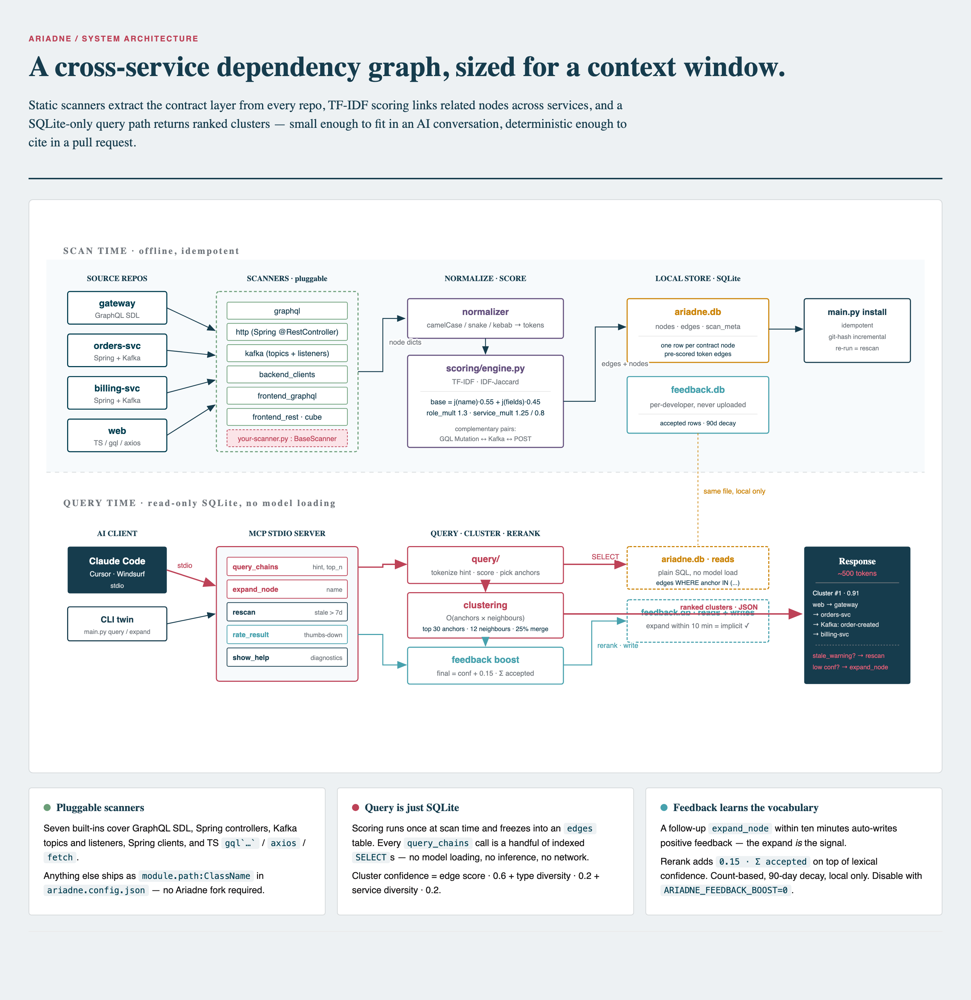

# Architecture

How Ariadne produces cross-service clusters from source code.



<sub>Brand tokens from
[VoltAgent/awesome-design-md](https://github.com/VoltAgent/awesome-design-md),
rendered via
[Cocoon-AI/architecture-diagram-generator](https://github.com/Cocoon-AI/architecture-diagram-generator).</sub>

## Layout

```
ariadne/
├── scanner/       # per-framework extractors → node dicts
├── normalizer/    # camelCase/snake/kebab → tokens
├── scoring/
│   └── engine.py  # TF-IDF + IDF-Jaccard → token edges
├── store/         # SQLite: ariadne.db / feedback.db
├── query/         # query / expand — pure SQLite reads
├── evaluation.py  # JSONL judgments → hit rate / MRR
├── mcp_server.py  # MCP stdio server
├── main.py        # CLI + scan orchestration
└── tests/         # pytest suite
```

## Scoring

Token-based scoring runs at scan time and populates the `edges` table.
Query time reads edges via plain SQLite — no model loading, no inference.

### Token edges (`scoring/engine.py`)

Information retrieval on tokenized node names. `createOrder` →
`["create", "order"]`, compared via IDF-weighted Jaccard:

```
idf_jaccard(A, B) = Σ idf(t)  (t ∈ A ∩ B)  /  Σ idf(t)  (t ∈ A ∪ B)
idf(t)            = log(N / df(t))
```

Rare tokens dominate; high-frequency domain words (`task`, `id`, `service`)
self-dampen, no stopword list needed.

```
base  = idf_jaccard(name) * 0.55 + idf_jaccard(fields) * 0.45
token_total = min(base * role_mult * service_mult, 1.0)

role_mult    = 1.3   for complementary pairs
                     (GraphQL Mutation ↔ Kafka topic ↔ HTTP POST,
                      GraphQL Query ↔ Cube Query ↔ HTTP GET)
service_mult = 1.25  cross-service / 0.8 same-service
```

The "different names, same concept" problem
(`assignHomework` ↔ `assignStudentsToTask`) is handled by the feedback
boost below — no embeddings needed.

## Clustering

Two-stage, `O(anchors × neighbours)`, independent of repo count.

1. Tokenize the hint, score against all nodes, keep the top 30 anchors
   with `score ≥ 0.15`.
2. For each anchor, pull its edges from the DB (single `IN` query) and
   keep the top 12 neighbours with `edge_score ≥ 0.25`.
3. Merge anchor neighbourhoods that overlap by ≥ 25%.
4. Per cluster, take top 2 nodes per `(service, type)`, capped at 12.
5. `confidence = mean_edge_score · 0.6 + type_diversity · 0.2 + service_diversity · 0.2`

## Feedback reranking

`feedback.db` stores local exploration and explicit usefulness judgments.
Queries retain their result association for ten minutes, including after an
expansion. An expansion records the actual expanded source IDs once per query
cluster. Explicit `rate_result` can infer returned node IDs from hint and rank;
rank zero refers to a recent expansion. Rescanning clears these associations.

Only explicit (`source=manual`) judgments from the last 90 days affect ranking.
For each visible node with judgments, compute `(accepted - rejected) / total`;
the cluster adjustment is 0.10 times the mean of these values. Add that bounded
adjustment to lexical confidence and clamp the result to [0, 1]. This is a ranking
score, not a calibrated probability. Repeated identical judgments cannot increase
the adjustment beyond its bound. Empty or exploration-only feedback preserves
the lexical result, including its serialized representation.

`ARIADNE_FEEDBACK_BOOST=0` disables feedback reranking. The quality experiment
reports feedback's effects separately from baseline lexical retrieval; local
feedback counts alone do not establish retrieval accuracy.

## Contract evidence and empty results

Every returned node includes `source_file`. Source discovery prunes generated
and vendor directories before reading files. Edge scoring uses the same unique
node IDs that queries read from SQLite. Scan reuse requires unchanged HEAD,
repository path, scanner configuration and extraction format.

REST routes and their final literal segments participate in anchor relevance,
so a handler named `get` or `save` can be found by its route. Multi-token hints
require a majority of their effective business terms in an anchor; structural
`GraphQL subscription` hints select subscription operations rather than billing
operations. If valid anchors form no cluster, query returns at most three
stable singleton results. No eligible anchor produces an empty result with
MCP guidance to refine the identifier or search source.

## Evaluation

`ariadne-mcp eval <judgments.jsonl>` is the offline ranking gate. Each
judgment names a query hint and the node ids that should appear in a top-k
cluster:

```json
{"hint":"createOrder","expected_node_ids":["gateway::gql::m::createOrder"],"k":3}
```

The evaluator reuses the same `query()` path as the CLI/MCP server, then
computes:

- `hit_rate`: fraction of judgments where a matching cluster appears in top-k.
- `MRR`: mean reciprocal rank of the first matching cluster.

For comparable top-k numbers, `eval` uses a stable internal candidate depth
before slicing to `--top`. That avoids comparing different cluster sets when
checking `--top 1`, `--top 3`, and `--top 5`.

By default a judgment is satisfied when any expected node id appears in a
cluster. Set `"match": "all"` when all expected node ids must appear in the
same cluster. CI can pass `--min-hit-rate` and `--min-mrr` to turn regressions
into a non-zero exit code.

## MCP tools

What an AI assistant sees once `install` is done:

| Tool           | Args                                  | Purpose                                |
|----------------|---------------------------------------|----------------------------------------|
| `query_chains` | `hint`, `top_n` (default 3)           | Business term → cross-service clusters |
| `expand_node`  | `name` (partial match supported)      | One-hop neighbours of a known node     |
| `rescan`       | *(none)*                              | Refresh the index in place; git-hash incremental |
| `show_help`    | *(none)*                              | Setup guide + runtime config diagnostics |
| `rate_result`  | `hint`, `accepted`, `cluster_rank`, `node_ids` | Manual feedback; can infer node ids from recent `query_chains` |

## Re-scan trigger

MCP responses include `stale_warning` when a recorded repository is missing,
its HEAD differs from the scanned revision, or the oldest scan is at least seven
days old. New index metadata records repository paths; older indexes gain
revision checks after rescanning. CLI warnings currently check scan age.

From an AI conversation, call `rescan()`; from the shell,
`ariadne-mcp scan --config <path> --force`. Uncommitted source edits require an
explicit forced scan; HEAD checks do not certify an unchanged working tree.
